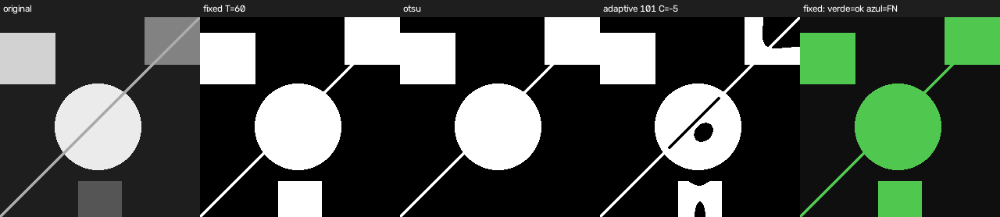
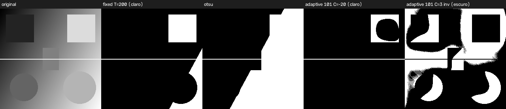
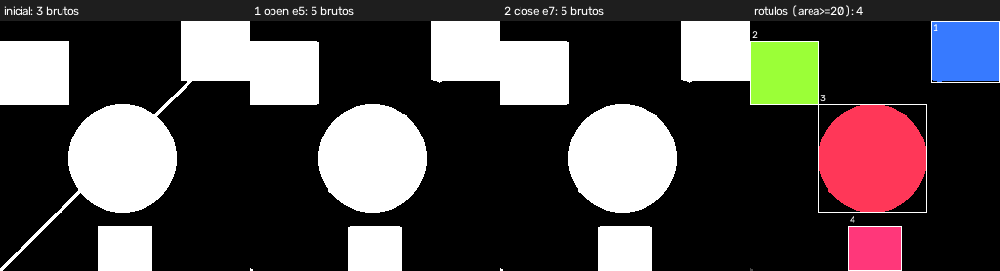
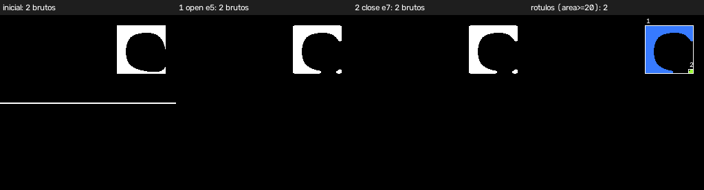
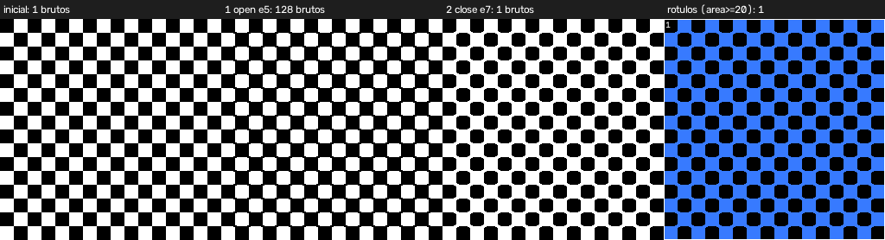
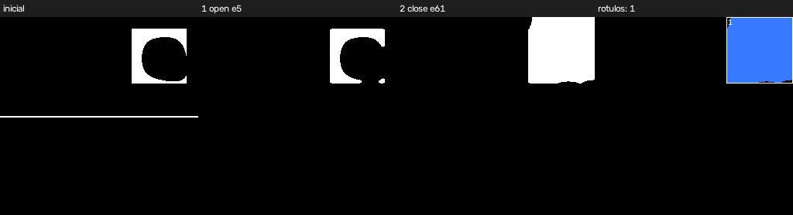

# Mini relatório — Laboratórios M2.1 e M2.2

## Identificação

- Estudante: PREENCHER
- Matrícula: PREENCHER
- Laboratórios: M2.1 (máscara binária e segmentação) e M2.2 (componentes conexos e sequência morfológica)
- Linguagem: Python 3.13 + OpenCV headless 5.0.0.93 (projeto único `pdi_lab`, operações `segment` e `analyze`)

Todos os números vêm de `results/tabelas.md`, `results/study_summary.json`, `results/m2_1_sensibilidade.csv`, dos CSV/JSON em `results/` e dos JSON de `images/output/`, produzidos por `python tools/run_study.py` (comandos completos no `README.md`). As imagens são as **fornecidas pelo professor** no template (`images/input/m1_*.png`).

## Objetivo, operações e decisões de implementação

**Objetivo.** Estender o projeto `pdi_lab` com duas operações: `segment` (M2.1), que gera uma máscara binária por limiarização, e `analyze` (M2.2), que rotula componentes conexos, aplica uma sequência morfológica e recontagem antes/depois, deixando rastreáveis a imagem original, a máscara inicial, cada estágio e a contagem final.

**Operações implementadas.**
- `segment`: métodos `fixed`, `otsu`, `adaptive` e `hsv`, com `--invert` e `--blur`; saída PNG 8 bits, 1 canal, valores {0, 255}, mais um `<saída>.json` com os parâmetros.
- `analyze`: rotulação com `--connectivity 4|8`, filtro `--min-area`, sequência morfológica (`--morph` ou `--morph-config`), CSV inicial e final, imagens de rótulos, um PNG por estágio e `P_summary.json`.
- As operações da M1 do template continuam como *stubs*; `segment` permanece executável junto com `analyze`, no mesmo código.

**Decisões de implementação.**
- Os roteiros da M2 permitem usar o OpenCV (`threshold`, `adaptiveThreshold`, `inRange`, `morphologyEx`, `connectedComponentsWithStats`); não há implementação manual dessas operações. A lógica de parâmetros, guardas, validação de saída e relatórios é código do projeto.
- Os parâmetros são validados em um módulo próprio (`m2_params.py`) antes de qualquer leitura de imagem, com os códigos de saída do contrato (2 argumento ausente, 3 leitura, 4 escrita, 5 parâmetro inválido, 6 operação desconhecida).
- A máscara é gravada, relida e conferida (1 canal, mesmo tamanho, `uint8`, só 0 e 255). Saídas com perda (JPEG) são recusadas.
- No limiar fixo, pixel > T vira 255 e pixel = T fica no fundo; com `--invert`, vale pixel <= T.
- `--min-area` mantém o componente com área >= valor; o CSV marca `kept` e as contagens brutas e filtradas ficam no resumo.
- A soma das áreas brutas é conferida contra os pixels de primeiro plano da máscara em cada execução.
- A sequência morfológica exige pelo menos 2 etapas, com abertura ou fechamento, e recusa duas etapas consecutivas idênticas.

---

# M2.1 — Máscara binária e segmentação

## 1. Alvo e imagens

Duas imagens 256×256 em tons de cinza, mais uma terceira usada só na M2.2 (conectividade):

| Imagem | Papel | O que contém |
|---|---|---|
| `m1_shapes_border_256.png` | favorável | fundo escuro (30); retângulo (210), quadrado (130), círculo (235), quadrado inferior (85) e uma **linha diagonal fina** (170, ≈ 5 px de largura medida na horizontal) que liga o círculo ao quadrado superior direito; quatro elementos tocam a borda (retângulo, os dois quadrados e a linha) |
| `m1_gray_scene_256.png` | difícil (**iluminação**) | fundo com gradiente de 0 a 255; três formas só ligeiramente mais escuras que o entorno (um quadrado e dois círculos), um quadrado **claro**, uma faixa quase invisível e uma linha horizontal clara de 2 px |
| `m1_checkerboard_256.png` | extra (M2.2) | tabuleiro com células de 16 px (níveis 40 e 220) |

**Alvo:** "formas geométricas da cena", sem a linha fina. Contagem **manual** por inspeção visual (origem: leitura das imagens): `m1_shapes_border_256` tem 5 elementos (4 formas + a linha diagonal, que conto como elemento porque tem nível de cinza próprio); `m1_gray_scene_256` tem 5 formas (a linha horizontal é tratada como artefato, não objeto); o tabuleiro tem 128 quadrados claros (16 × 16 células, metade claras).

Duas dificuldades das imagens limitam o que a M2.1 pode fazer: (i) em `m1_gray_scene_256` as formas têm contraste muito baixo contra o gradiente (estimativa feita por mim com regiões lidas na figura, não reproduzida pelo script: de ≈ −9 a ≈ −20 níveis nas formas escuras e ≈ +3 na faixa, contra ≈ +69 no quadrado claro); (ii) as formas **escuras** e **claras** da cena têm polaridades opostas em relação ao entorno, e um único método com uma única polaridade só captura um dos grupos. Por isso a segmentação "para valer" nessa imagem recupera apenas o quadrado claro; as demais formas são falsos negativos documentados abaixo, não um acerto.

Os originais não são alterados pelo processamento (há teste automático).

## 2. Configurações e parâmetros

Sem pré-processamento algum: as imagens são sintéticas e sem ruído, então a suavização não tem o que corrigir (a única falha dominante, o gradiente, não é ruído). Em `m1_shapes_border_256` e na tentativa clara de `m1_gray_scene_256` os objetos são **mais claros** que o entorno, logo não há inversão; só a última linha da tabela inverte (objeto escuro) e serve para documentar uma falha.

| Imagem | Configuração | Método e parâmetros |
|---|---|---|
| shapes | `fixed` | limiar fixo T = 60 (pixel > 60 ⇒ objeto) |
| shapes | `otsu` | limiar calculado (Otsu): 85 |
| shapes | `adaptive` | adaptativo gaussiano, bloco 101, C = −5 (pixel > média local + 5) |
| scene | `fixed` | limiar fixo T = 200 |
| scene | `otsu` | limiar calculado (Otsu): 133 |
| scene | `adaptive` | adaptativo gaussiano, bloco 101, C = −20 (pixel > média local + 20) |
| scene | `adaptive_dark` | adaptativo, bloco 101, C = 3, **com inversão** (pixel ≤ média local − 3): formas escuras |

Os valores T = 60 e T = 200 e os parâmetros do adaptativo foram escolhidos **olhando as imagens e a varredura da seção 5**; estão sintonizados nestas imagens, não são valores gerais. T = 60 está no vale entre o fundo (30) e o elemento mais escuro (85); T = 200 fica logo abaixo do nível do quadrado claro (≈ 220).

## 3. Resultados

Proporção de primeiro plano (255) em 65 536 pixels e componentes conexos da máscara (conectividade 8, sem filtro):

| Imagem | Configuração | 1º plano (px) | Proporção | Componentes | Maior componente (px) |
|---|---|---:|---:|---:|---:|
| shapes | fixed (T=60) | 21 835 | 33,32 % | 3 | 14 573 |
| shapes | otsu (85) | 19 259 | 29,39 % | 2 | 14 573 |
| shapes | adaptive (101, −5) | 19 092 | 29,13 % | 3 | 12 148 |
| scene | fixed (T=200) | 9 353 | 14,27 % | 2 | 5 041 |
| scene | otsu (133) | 30 606 | 46,70 % | 1 | 30 606 |
| scene | adaptive (101, −20) | 2 757 | 4,21 % | 2 | 2 245 |
| scene | adaptive_dark (101, 3, inv) | 25 249 | 38,53 % | 17 | 8 920 |

Em `m1_shapes_border_256` cada elemento tem nível de cinza próprio, então dá para medir **a fração dos pixels de cada elemento marcada** (origem: valores de pixel da própria imagem; é a única medida deste tipo, e coincide com o que um limiar entre 30 e 84 daria, por construção):

| Configuração | quadrado inf. (85) | quadrado sup. dir. (130) | linha (170) | retângulo (210) | círculo (235) | fundo marcado (px) |
|---|---:|---:|---:|---:|---:|---:|
| fixed T=60 | 100 % | 100 % | 100 % | 100 % | 100 % | 0 |
| otsu | **0 %** | 100 % | 100 % | 100 % | 100 % | 0 |
| adaptive 101, −5 | 88 % | 59 % | 74 % | 100 % | 95 % | 0 |

Para `m1_gray_scene_256` **não há referência**, então não declaro acurácia, precisão ou revocação: só proporções, contagens e a inspeção visual das figuras.

*Figura 1 — `m1_shapes_border_256`: original, fixed, otsu, adaptive e (último painel) fixed contra os elementos por nível de cinza (verde = marcado; não houve vermelho nem azul). O `otsu` omite o quadrado inferior; o `adaptive` deixa buracos no miolo do círculo e dos quadrados.*

*Figura 2 — `m1_gray_scene_256`: original, fixed T=200, otsu, adaptive (claro) e adaptive (escuro). O `fixed` recupera o quadrado claro exato, mas junta uma região clara do canto inferior direito e a linha; o `otsu` pega toda a metade clara; o `adaptive` claro marca o quadrado só como um "C" (miolo vazio) mais a linha; o `adaptive_dark` produz fragmentos sem relação com as formas.*

## 4. Configuração de trabalho para a M2.2

- **`m1_shapes_border_256` → `fixed` T = 60.** É a única das três que cobre os 5 elementos (100 % de cada um) sem nenhum pixel de fundo. O `otsu` perde o elemento de nível 85 (seu limiar, 85, coincide com ele e o critério é "pixel > T"); o `adaptive` fragmenta os elementos grandes.
- **`m1_gray_scene_256` → `adaptive` (101, C = −20).** Escolha de compromisso, que explico porque nenhuma é boa. O `fixed` T = 200 recupera o quadrado claro exato (71 × 71 = 5 041 px), mas inclui um segundo componente de 4 312 px (região clara do fundo + linha) que atravessa a imagem na largura inteira e a morfologia não remove; só um filtro de área ajustado entre 4 312 e 5 041 px o separaria do quadrado, o que seria sintonizar o critério ao resultado. O `adaptive` tem um erro menor e **fino**: o quadrado sai como um "C" com miolo vazio (2 245 px, 44,5 % de 5 041) e a linha vira um componente de 512 px, que uma abertura remove. Escolho a máscara cujos erros a M2.2 consegue tratar.

**Falsos negativos e positivos visíveis na máscara de trabalho da cena** (Figura 2, 4º painel): falsos negativos — o quadrado escuro, os dois círculos, a faixa e o miolo do quadrado claro; falso positivo — a linha horizontal de 2 px. Só 1 das 5 formas é recuperada, e parcialmente.

## 5. Discussão comparativa

Varredura completa em `results/m2_1_sensibilidade.csv`.

**(a) Quando o limiar fixo funcionou e quando falhou.** *Funcionou* em `m1_shapes_border_256`: qualquer T entre 40 e 84 dá exatamente a mesma máscara (33,32 % de primeiro plano, 3 componentes, 5/5 elementos). *Falhou* em `m1_gray_scene_256`: como o fundo varia de 0 a 255, o limiar separa "metade clara × metade escura" em vez de "forma × fundo": T = 100 → 62,04 % em 1 componente; T = 150 → 40,28 % em 1 componente de 26 395 px; T = 180 → 19,57 % em 1 componente de 12 828 px; só T = 200 isola o quadrado claro, ainda com a região extra, e T = 230 já deixa o quadrado todo de fora (220 < 230).

**(b) Parâmetro mais sensível.** No `fixed`, o limiar, de forma **em degraus** definida pelos níveis da imagem: em `m1_shapes_border_256`, T = 84 pega 5 elementos, T = 85 e T = 100 pegam 4, T = 130 pega 3, T = 170 pega 2 e T = 210 pega 1 (T = 20 marca a imagem inteira, 100 %). No `adaptive`, o **tamanho do bloco**: em `m1_gray_scene_256` com C = −20, bloco 31 dá 10 componentes (1,87 %), 51 dá 8, 101 dá 2 (4,21 %) e 151 dá 3 (6,45 %); em `m1_shapes_border_256` com C = −5, bloco 31 cobre só 1 elemento, 51 cobre 4 e 101 e 151 cobrem 5 (mas com miolo vazio nos elementos grandes). O `C` tem efeito forte na cena: C = −10 → 9,18 % e 8 componentes; C = −30 → 2,77 % e 2 componentes; C = −40 → 1,75 % e 3 componentes.

**(c) Erros que atrapalham a contagem de objetos na M2.2.** (i) *Contato*: a linha fina liga o círculo e o quadrado superior direito, formando **um** componente de 14 573 px para 3 elementos; (ii) *miolo vazio e fragmentação* dos métodos adaptativos, que não mudam muito a contagem mas fragmentam ou vazam os objetos; (iii) *região falsa* grande no `fixed` da cena, que vira "objeto"; (iv) *linhas finas* (diagonal e horizontal) que aparecem como componentes próprios ou conectam outros; (v) objetos que tocam a borda contam como um componente mesmo cortados.

**Observação visual × métrica.** Só `m1_shapes_border_256` tem uma medida quantitativa (cobertura por elemento, derivada dos níveis de cinza). Para `m1_gray_scene_256` e o tabuleiro só valem as proporções, as contagens e a inspeção das figuras.

## 6. Validação das saídas

O programa relê a máscara gravada e confere: 1 canal, mesmas dimensões da entrada, `uint8`, valores só em {0, 255}; o resultado fica em `<mascara>.json` (`checks.ok = true` em todas as execuções do estudo). A saída é PNG; JPEG é recusado (código 5). Há testes automáticos (`tests/test_m2_segment.py`).

---

# M2.2 — Componentes conexos e sequência morfológica

## 1. Partida: a máscara inicial

A entrada de `analyze` é a saída de `segment` da configuração de trabalho (**objeto = 255, fundo = 0**): `fixed` T = 60 para `m1_shapes_border_256`, `adaptive` 101/−20 para `m1_gray_scene_256` e `fixed` T = 128 para o tabuleiro. O programa guarda uma cópia sem alteração (`results/_initial_mask.png`) e verifica que a entrada só tem 0 e 255.

## 2. Rotulação e conectividade 4 versus 8

Mesma máscara inicial, parâmetros idênticos, rótulo de fundo excluído:

| Máscara | Componentes (4) | Componentes (8) | Soma das áreas (4 e 8) | Pixels de 1º plano |
|---|---:|---:|---:|---:|
| shapes (fixed T=60) | 3 | 3 | 21 835 | 21 835 |
| scene (adaptive 101, −20) | 2 | 2 | 2 757 | 2 757 |
| tabuleiro (fixed T=128) | **128** | **1** | 32 768 | 32 768 |

**Diferenças.** A conectividade 4 liga só pixels que compartilham lado; a 8 também liga pelos cantos. Nas duas imagens de formas **não houve diferença** (3 = 3 e 2 = 2): os contornos são compactos e a linha diagonal tem 5 px de largura medida na horizontal, o suficiente para ser conexa também em 4. No **tabuleiro** a diferença é total: os 128 quadrados claros só se tocam pelos vértices, então em 4 há 128 componentes (a contagem humana) e em 8 há **1** (um único componente de 32 768 px). Em todos os casos a soma das áreas dos componentes brutos é igual aos pixels de primeiro plano (conferida pelo programa e por teste, para 4 e para 8). Também há o teste sintético de dois pixels só na diagonal (2 em 4, 1 em 8).

**Escolha para a análise final: conectividade 8**, adotada porque contornos digitais de um mesmo objeto podem se tocar só pelo canto; para as duas imagens de formas a escolha não altera nenhuma contagem. O tabuleiro mostra o custo: com 8, objetos que se tocam por um vértice viram um só.

## 3. Sequência morfológica

| Ordem | Operação | Elemento | Iterações | Problema visado |
|---:|---|---|---:|---|
| 1 | abertura (`open`) | elipse 5×5 (17 px) | 1 | remover estruturas finas (a linha de ≈ 3,5 px de espessura perpendicular, que liga formas em `m1_shapes_border_256` e atravessa a cena) e saliências pequenas |
| 2 | fechamento (`close`) | elipse 7×7 (33 px) | 1 | fechar pequenos buracos e frestas dentro dos objetos (miolo vazado dos métodos adaptativos) |

Usei elemento elíptico por ser o formato usual para formas arredondadas; ele pode arredondar levemente cantos retos (não medi esse efeito) e não comparei com elemento retangular nas três imagens.

**Por que nesta ordem.** A abertura primeiro, para desfazer o contato antes de qualquer outra coisa; o fechamento depois, para reparar o que a abertura e a segmentação deixaram. A ordem inversa foi testada (`close 7 → open 5`, `results/*_ordem_inversa_*`).

*Figura 3 — `m1_shapes_border_256`: máscara inicial (3 componentes) → abertura (5) → fechamento (5) → rótulos finais (4 mantidos com área ≥ 20).*

*Figura 4 — `m1_gray_scene_256`: máscara inicial (2) → abertura (2) → fechamento (2) → rótulos finais (2 mantidos).*

*Figura 5 — tabuleiro: inicial (1 componente em conectividade 8) → abertura (128) → fechamento (1) → rótulos.*

### Efeito por estágio (conectividade 8, `--min-area 20`)

| Imagem | Estágio | Operação | 1º plano (px) | Brutos | Mantidos |
|---|---:|---|---:|---:|---:|
| shapes | 0 | máscara inicial | 21 835 | 3 | 3 |
| shapes | 1 | open 5×5 | 21 262 | 5 | 4 |
| shapes | 2 | close 7×7 | 21 263 | 5 | 4 |
| scene | 0 | máscara inicial | 2 757 | 2 | 2 |
| scene | 1 | open 5×5 | 2 130 | 2 | 2 |
| scene | 2 | close 7×7 | 2 131 | 2 | 2 |
| tabuleiro | 0 | máscara inicial | 32 768 | 1 | 1 |
| tabuleiro | 1 | open 5×5 | 31 868 | **128** | 128 |
| tabuleiro | 2 | close 7×7 | 34 568 | **1** | 1 |

**Perda de detalhes, fusão e contorno.**
- **shapes:** a abertura **cortou a linha** e desfez o contato: o componente de 14 573 px (círculo + linha + quadrado superior direito) virou o círculo isolado (9 667 px) e o quadrado (4 335 px). O preço: **perdeu detalhe real** — após a sequência, só 56 % dos pixels da linha seguem marcados (os que estão dentro do círculo e do quadrado). Surgiu também um fragmento de 7 px (3 × 3 em x = 0, y = 253): é o que restou da ponta da linha no canto da imagem (provavelmente um efeito de borda da erosão do OpenCV, que não testei isoladamente). O filtro de área o descarta (7 < 20). O fechamento praticamente não fez nada (+ 1 px): não havia buracos a fechar.
- **scene:** a abertura removeu a linha horizontal (componente de 512 px) como esperado, mas **gerou um fragmento do próprio quadrado**: sobraram o "C" (2 091 px) e um fragmento de 40 px em (233, 79), dentro da caixa do quadrado, que o filtro de 20 px **mantém**. O fechamento 7×7 (+ 1 px) não corrige o "C": o miolo vazio é grande demais.
- **tabuleiro:** a abertura rompeu os contatos de canto e separou os 128 quadrados (a contagem humana); o fechamento seguinte **os fundiu de novo** em 1 componente e engordou a máscara em 2 700 px (31 868 → 34 568, +5,5 % sobre a inicial). **A segunda operação desfez o que a primeira conseguiu.**

**Variações testadas (`results/*_ordem_inversa_*` e `*_fechamento61_*`).**

| Imagem | Sequência | 1º plano final (px) | Brutos → mantidos |
|---|---|---:|---|
| shapes | open 5 → close 7 (adotada) | 21 263 | 5 → 4 |
| shapes | close 7 → open 5 | 21 323 | 5 → 4 |
| shapes | open 5 → **close 61** | 24 501 | 3 → 2 |
| scene | open 5 → close 7 (adotada) | 2 131 | 2 → 2 |
| scene | close 7 → open 5 | 2 136 | 2 → 2 |
| scene | open 5 → **close 61** | 7 228 | 1 → 1 |

A **ordem** praticamente não mudou nada nestas imagens (diferenças de 60 px em shapes e 5 px em scene; mesmas contagens), porque não há ruído que um fechamento antecipado pudesse engordar; não vou afirmar que a ordem escolhida seja "melhor" além de a abertura primeiro ser a que evita soldar fragmentos finos. O **tamanho** do fechamento, ao contrário, importa muito: com 61×61 o fechamento (a) em **shapes** funde formas vizinhas (5 → 3 componentes brutos, + 2 666 px sobre a máscara inicial) e (b) em **scene** transforma o quadrado em um componente de 7 228 px com caixa (170, 0, 86, 86): estende-se até a borda superior da imagem e tem 2,6 vezes a área da máscara inicial (2 757 px) e 3,2 vezes a do componente do quadrado (2 245 px) — é um artefato, não o quadrado de 71 × 71.

*Figura 6 — `m1_gray_scene_256` com fechamento 61×61: o quadrado "enche" e encosta no topo da imagem (artefato).*

## 4. Recontagem antes/depois

Critério de filtragem **explícito**: componente mantido se **área ≥ 20 px** (`--min-area 20`, valor do exemplo do roteiro), aplicado igualmente à máscara inicial e à final; o rótulo de fundo nunca é contado.

| Imagem | Contagem manual | Antes: bruto → mantido | 1º plano antes (px) | Depois: bruto → mantido | 1º plano depois (px) |
|---|---:|---|---:|---|---:|
| shapes | 5 | 3 → 3 | 21 835 | 5 → 4 | 21 263 |
| scene | 5 | 2 → 2 | 2 757 | 2 → 2 | 2 131 |
| tabuleiro | 128 | 1 → 1 | 32 768 | 1 → 1 | 34 568 |

Imagens de rótulos e caixas: `results/_labels.png` (final) e `_labels_initial.png`; CSV: `results/_initial.csv` e `_final.csv` (todos os componentes com `kept`).

Observações sobre as mudanças:

1. **shapes: de 3 para 4 componentes mantidos.** A contagem *aumentou* porque o componente em contato (14 573 px) foi separado em círculo e quadrado; os 4 mantidos coincidem com as **4 formas**, mas a contagem manual é 5 (a linha), então há um subcontagem de 1 por causa da perda de detalhe. Os 4 componentes finais têm 4 335, 4 682, 9 667 e 2 572 px; o quadrado superior direito (4 335 px, caixa 71 × 63 em (185, 0)) aparece **cortado pela borda da imagem** e é contado normalmente.
2. **scene: 2 componentes mantidos, mas ambos pertencem ao mesmo quadrado claro** (o "C" de 2 091 px e um fragmento de 40 px) — contagem 2 para 1 objeto recuperado (de 5 formas reais). A área total caiu de 2 757 para 2 131 px (−22,7 %), em parte por ter removido a linha de 512 px (que não é objeto) e em parte por ter perdido pixels do próprio "C".
3. **tabuleiro: a contagem final (1) está errada por 127** em relação aos 128 quadrados; a máscara cresceu 5,5 %.

## 5. Limitações e efeitos indesejados

**Onde a sequência ajudou.** Em `m1_shapes_border_256` a abertura separou formas que a linha fina mantinha em um só componente: de 3 para 4 componentes mantidos, um por forma. Em `m1_gray_scene_256` removeu a linha horizontal, um falso positivo. No tabuleiro, a abertura, sozinha, recuperou a contagem humana de 128.

**Onde prejudicou ou não resolveu.**
- *Detalhe real perdido:* a linha diagonal de `m1_shapes_border_256` é um elemento da imagem e foi apagada junto com o contato; a abertura não distingue "ligação indesejada" de "objeto fino".
- *Fechamento desfaz a abertura:* no tabuleiro o par abertura → fechamento volta a 1 componente; a sequência, aplicada às cegas, é pior que só a abertura.
- *Fragmentação por abertura:* na cena a abertura criou um fragmento de 40 px que o critério de 20 px não elimina.
- *Não resolveu:* o miolo vazio em "C" da máscara adaptativa e a ausência das outras 4 formas da cena (falhas da segmentação, não da morfologia).
- *Fechamento grande:* 61×61 cria artefatos que mudam a área e a forma (Figura 6).

**Contagem e interpretação humana.** Em `m1_shapes_border_256` a contagem final de 4 se aproxima de uma leitura humana que conta as **formas** (4), mas não da que conta todos os **elementos** (5). Em `m1_gray_scene_256` 2 componentes para 5 formas está longe da interpretação humana (e os 2 vêm do mesmo quadrado). No tabuleiro o resultado final (1) contraria a contagem humana (128), enquanto a conectividade 4 sobre a máscara inicial já a dava. Por isso o número de componentes detectados **não equivale ao número real de objetos**: contato, fragmentação, objetos de baixo contraste e escolhas de conectividade e de morfologia alteram a contagem em ambos os sentidos.

## 6. Testes realizados

71 testes automáticos (`python -m pytest`): 6 do template e 65 da M2.

| Teste | Entrada | Operação | Critério de verificação |
|---|---|---|---|
| Limiar nos dois lados | imagem sintética `[0, 99, 100, 101, 255]` | `segment fixed T=100` | `[0, 0, 0, 255, 255]` (pixel = T fica no fundo); invertido `[255, 255, 255, 0, 0]`; T = 0 e T = 255 |
| Otsu, adaptive, HSV | imagens sintéticas (dois níveis; gradiente + bloco escuro; cores com matiz vermelho dos dois lados do 0) | `segment` | máscara esperada; faixa HSV 170→10 pega H = 0 e H ≈ 176 e ignora o verde |
| Falhas | método desconhecido; sem `--method`/`--threshold`; T = 300, −1, "abc"; blur par; entrada inexistente ou corrompida; saída `.jpg` | `segment` | códigos 5, 2, 3 e saída não criada |
| Máscara de saída | `shapes` (fixed, otsu) e `scene` (fixed, adaptive) | `segment` | 1 canal, mesmas dimensões, `uint8`, valores em {0, 255}, original intacto |
| Sensibilidade (shapes) | níveis 85, 130, 170, 210, 235 | `segment` | T = 60 cobre os 5; T = 100 e T = 85 perdem o de nível 85; Otsu calcula 85 e também perde |
| Falha por iluminação (scene) | gradiente | `segment fixed` | T = 150 → 1 componente de > 20 000 px; T = 200 → quadrado de 71 × 71 + região de > 4 000 px com largura 256 |
| Limitação do adaptativo | gradiente + bloco escuro 20 × 20 | `segment adaptive` | bloco 61 acha o bloco inteiro; bloco 31 deixa o miolo vazio |
| Diagonal 4×8 | 2 pixels só na diagonal | `analyze` | 2 componentes (4), 1 componente (8) |
| Tabuleiro | `m1_checkerboard_256` | `analyze` | 128 componentes (4) e 1 (8); abertura → 128; fechamento → 1 |
| Abertura e fechamento | ruído isolado + quadrado; furo de 1 pixel | `apply_step` | ruído some e o quadrado 20×20 permanece; furo preenchido |
| Casos de borda | máscara vazia; objeto no canto; máscara toda branca | `analyze` | 0 componentes e CSV só com cabeçalho; `touching_border = 1`; 1 componente |
| Parâmetros inválidos | `--connectivity 3/6/abc`; `--min-area -1`; sequência de 1 passo, sem open/close, com passos idênticos, tamanho par, 0 iterações; entrada não binária ou colorida | `analyze` | código 5 (ou 3 para arquivo de configuração inexistente), sem criar resumo |
| CSV | máscara com componentes de área 24 e 1 | `analyze --min-area 5` | cabeçalho exato, caixa `(6,5,6,4)`, centroide `(8,5; 6,5)`, `kept` correto, rótulo 0 ausente |
| Imagens do estudo | `shapes`, `scene`, tabuleiro | `segment` + `analyze` | soma das áreas brutas = pixels de 1º plano (inicial e final); `kept` coerente com `área ≥ 20`; arquivos de estágios, rótulos, CSV e resumo existem |
| shapes: contato e borda | `m1_shapes_border_256` | `analyze` | 3 componentes iniciais (um de 14 573 px), 3 tocam a borda; final 5 brutos/4 mantidos, fragmento de 7 px em (0, 253) descartado, retângulo na borda mantido |
| scene: linha | `m1_gray_scene_256` | `analyze` | componentes iniciais de 512 e 2 245 px; linha (512) ausente no final |
| Configuração por arquivo | JSON com `ellipse` | `analyze --morph-config` | sequência lida do arquivo e registrada no resumo |

## 7. Limitações da implementação

- Só há medida quantitativa de cobertura em `m1_shapes_border_256`; nas demais imagens não há máscara de referência.
- Os parâmetros (T = 60 e 200, bloco 101, C = −5 e −20, elementos 5×5 e 7×7, `min-area` 20) foram escolhidos para estas imagens e **não** são gerais.
- A segmentação de `m1_gray_scene_256` só recupera o quadrado claro; as formas escuras e a faixa de baixo contraste ficam de fora. A tentativa com a polaridade oposta (`adaptive_dark`) está registrada no estudo e falhou. Também testei, de forma exploratória, uma correção de iluminação por *black-hat*: falhou e **não** está no código entregue (não reporto números dela).
- As estimativas de contraste das formas da cena foram feitas com regiões lidas visualmente e não são reproduzidas pelo script.
- O método `hsv` foi testado só com imagens sintéticas coloridas, porque as imagens usadas são em tons de cinza.
- Watershed, contornos e classificação (extensões opcionais) não foram implementados; por isso os contatos só podem ser tratados pela morfologia.
- `analyze` aceita só máscaras 8 bits de 1 canal com valores {0, 255}.
- As operações da M1 do template continuam como *stubs*.
- Duas imagens do template (`m1_color_scene_256.png` e `m1_gray_ramp_256.png`) **não abrem** (erro de CRC em IDAT no `libpng` do OpenCV; os arquivos são idênticos aos do repositório do template) e não foram usadas.

## 8. Declaração de uso de IA generativa

Utilizei IA generativa neste laboratório. Ferramenta: Claude (Anthropic), em conversa de chat com execução de código. Finalidade: assistente de desenvolvimento, que escreveu a primeira versão do código de `segment` e `analyze`, dos testes, do script do estudo e dos rascunhos de `README.md` e `REPORT.md`. As imagens de estudo são as fornecidas pelo professor. Validação: execução de `python -m pytest` (71 testes) e de `python tools/run_study.py`, e conferência dos números do relatório contra os CSV e JSON gerados. Modificações realizadas e link da conversa estão em `AI_USAGE.md`, que traz a declaração completa nos itens pedidos para a declaração.

## 9. Referências

- Documentação do OpenCV: `cv::threshold` (Otsu), `cv::adaptiveThreshold`, `cv::inRange`, `cv::getStructuringElement`, `cv::morphologyEx`, `cv::connectedComponentsWithStats`.
- Roteiros `laboratorio_M2_1.md` e `laboratorio_M2_2.md`, rubrica dos laboratórios da M2 (`rubrica-labs_m2.md`) e o projeto-base `pdi_template` (docs/ e READMEs), incluindo as imagens `m1_*` fornecidas.
- Uso de IA generativa: ver `AI_USAGE.md`.
